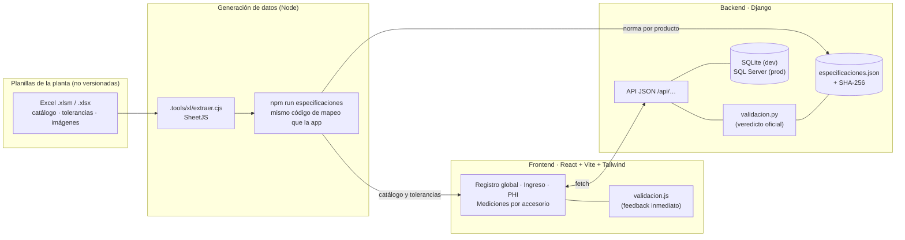

# Control Dimensional de Accesorios

Aplicación web para el **control de calidad dimensional de accesorios de tuberías termoplásticas**
(HDPE y PP-RCT; uniones por electrofusión, termofusión socket y fusión a tope), desarrollada para el
laboratorio de calidad de una empresa fabricante de tuberías y fittings. Reemplaza un flujo basado en
planillas Excel con macros VBA por una aplicación con **validación normativa en el servidor**,
trazabilidad de cada medición y un flujo de trabajo pensado para la planta.

> **Nota sobre los datos.** Las tolerancias, el catálogo de productos y las imágenes reales son
> propiedad de la empresa y **no forman parte de este repositorio**. El proyecto incluye un set de
> **datos DEMO ficticios** (`frontend/datos-demo/`) para poder ejecutarlo y evaluarlo.


---

## Contenido

- [Funcionalidades](#funcionalidades)
- [Arquitectura](#arquitectura)
- [Validación normativa en el servidor](#validación-normativa-en-el-servidor)
- [Flujo de trabajo de planta](#flujo-de-trabajo-de-planta)
- [Puesta en marcha](#puesta-en-marcha)
- [Pruebas](#pruebas)
- [Estructura del repositorio](#estructura-del-repositorio)
- [API](#api)
- [Decisiones de diseño](#decisiones-de-diseño)
- [Autor](#autor)

## Funcionalidades

- **Registro global por material y tipo de fusión**, equivalente a la hoja de registro de las planillas:
  fecha, hora, despacho, inspector, producto, marca, N° de operación, lote, ensayo PHI, inspección
  visual y estado de aprobación.
- **Ingreso de accesorios** en dos pasos: cabecera (la fecha del reporte es editable; la **hora la
  registra el servidor**) y formulario de mediciones por extremo, con el esquema de medición del
  accesorio al lado.
- **Evaluación dimensional en vivo**: cada casilla se colorea según su estado; las que están fuera de
  rango se marcan en **rojo con un tooltip** que explica el motivo
  (*"Valor medido 63.8 fuera del rango permitido [63 – 63.6] · desviación +0.2 mm"*).
- **Ensayo de presión hidrostática interna (PHI)** por despacho: condiciones comunes (presión,
  temperatura, tiempo) y resultado por accesorio (sin fallas, ruptura o filtración con su tiempo de fallo).
- **Estado de aprobación manual** (EN PROCESO / APROBADO / RECHAZADO), decidido por el inspector.
- **Vista de mediciones por accesorio**, con columnas agrupadas por extremo, como las hojas de detalle
  de las planillas.
- **Filtros en el servidor**: rango de fechas, despacho, inspector, búsqueda libre, resultado PHI,
  estado, dimensión y "solo fuera de rango".
- Fechas en formato chileno (**dd-mm-aaaa**) independiente del idioma del navegador y zona horaria
  `America/Santiago`.

## Arquitectura



| Capa | Tecnología | Responsabilidad |
|---|---|---|
| Frontend | React 19, Vite 8, Tailwind CSS 4 | Interfaz, evaluación instantánea mientras se mide, filtros |
| Backend | Django 5.2 (sin dependencias extra), Python 3.12 | API, validación oficial, persistencia, administración |
| Base de datos | SQLite en desarrollo · SQL Server en producción (`mssql-django`) | Ensayos y mediciones (`DecimalField`, 4 decimales) |
| Datos | Node + SheetJS | Extracción desde Excel y generación de la norma por producto |

## Validación normativa en el servidor

El punto central del diseño es que **el navegador nunca decide la norma**:

1. Las tolerancias (por tipo de extremo y diámetro, con límites de un solo lado cuando corresponde)
   se extraen de las planillas y se combinan con un **mapeo accesorio → extremos**
   (`frontend/src/config/extremos/*.js`) para obtener las cotas y límites de cada producto.
2. `npm run especificaciones` genera **`compartido/generated/especificaciones.json`** con *el mismo
   código* que usa la interfaz. Así frontend y backend no pueden aplicar reglas distintas.
3. Al guardar, el backend **ignora los límites que envía el navegador**: busca la especificación del
   producto, evalúa con `ensayos/dominio/validacion.py` y guarda en cada medición una **copia de los
   límites vigentes**. Si el navegador mostraba límites distintos (página desactualizada), se guarda
   igual y se devuelve una advertencia.
4. Cada ensayo registra **`version_norma`** (SHA-256 del archivo de especificaciones): siempre se
   puede saber con qué versión de la norma se evaluó.
5. La validación existe en JavaScript (feedback inmediato) y en Python (veredicto oficial). Ambas se
   prueban con **los mismos casos** (`compartido/casos-validacion.json`), incluido el redondeo
   (`toFixed` de JS replicado con `Decimal` y `ROUND_HALF_UP`).

Las celdas sin valor en las tablas (p. ej. `"-"`) se tratan como **"sin tolerancia"**, nunca como un
límite: una cota no se da por conforme si no hay contra qué compararla.

## Flujo de trabajo de planta

- **Guardado sin bloqueos.** Un ensayo se guarda siempre: incompleto (*borrador*) o con medidas fuera
  de rango. Solo se rechaza una petición mal formada. El laboratorio nunca pierde una medición por una
  validación.
- **Sin etiquetas globales rígidas.** No hay un "NO CONFORME" que bloquee el flujo; cada casilla fuera
  de rango se resalta en rojo con su motivo, y la aprobación final la decide el inspector.
- **Trazabilidad.** Inspector, fecha del reporte, hora del servidor, despacho, N° de operación, lote,
  límites aplicados y versión de la norma quedan en cada registro. El panel de administración es de
  solo lectura para los ensayos.

## Puesta en marcha

Requisitos: **Python 3.12+**, **Node.js 20+** y Git.

```bash
git clone https://github.com/bzrdub/control-dimensional-accesorios.git
cd control-dimensional-accesorios

# 1) Frontend + datos DEMO
cd frontend
npm install
npm run datos:demo          # copia datos-demo/ y genera la norma del backend
npm run dev                 # http://localhost:5173

# 2) Backend (en otra terminal)
cd backend
python -m venv .venv
# Windows: .venv\Scripts\activate    ·    Linux/macOS: source .venv/bin/activate
pip install -r requirements.txt
cp .env.example .env        # Windows: copy .env.example .env
python manage.py migrate
python manage.py sembrar_pruebas    # opcional: ingresos de prueba en el registro
python manage.py runserver          # http://127.0.0.1:8000 (Vite reenvía /api)
```

Los datos DEMO incluyen **HDPE · Fusión Socket** y **PP-RCT · Electrofusión** (4 accesorios cada uno,
tolerancias ficticias). Para producción con **SQL Server** ver [`backend/README.md`](backend/README.md).

## Pruebas

```bash
cd frontend && npm test                          # node:test — dominio, fechas, columnas, norma generada
cd backend  && python manage.py test ensayos     # Django — API, filtros, PHI, norma, comando de datos
```

Las pruebas que dependen de las tablas reales de la planta se **omiten automáticamente** cuando solo
están los datos DEMO.

## Estructura del repositorio

```
├── backend/                 Django
│   ├── config/              settings (configuración por .env, SQLite/SQL Server)
│   └── ensayos/
│       ├── dominio/         validacion.py — port 1:1 de la validación JS
│       ├── normas.py        carga de especificaciones.json (+ SHA-256, recarga por cambio)
│       ├── servicios.py     creación de ensayos (compartida por API y comandos)
│       ├── entrada.py       validación de las peticiones
│       ├── views.py         API JSON
│       └── management/      sembrar_pruebas (datos de prueba)
├── frontend/                React + Vite
│   ├── datos-demo/          catálogo y tolerancias ficticias
│   ├── scripts/             generación de la norma · instalación de datos DEMO
│   └── src/
│       ├── components/      Registro global, Ingreso, PHI, Mediciones, UI
│       ├── config/extremos/ mapeo accesorio → extremos → columnas de tolerancia
│       ├── domain/          lógica pura y probada (validación, especificación, fechas…)
│       └── data/            acceso a la API y a los datos generados
├── compartido/              casos de prueba comunes JS ↔ Python
└── .tools/xl/               extracción desde Excel (SheetJS)
```

## API

| Método | Ruta | Descripción |
|---|---|---|
| GET | `/api/salud/` | Estado y versión de la norma cargada |
| GET | `/api/catalogos/` | Inspectores, marcas y estados de aprobación |
| GET | `/api/ensayos/` | Registro con filtros: `material, fusion, accesorio, desde, hasta, despacho, inspector, q, phi, aprobacion, fuera, productoId, detalle` |
| POST | `/api/ensayos/` | Nuevo ingreso: cabecera + mediciones (la norma la pone el servidor) |
| GET · PATCH | `/api/ensayos/<id>/` | Detalle · cambio del estado de aprobación |
| POST | `/api/ensayos/phi/` | Ensayo PHI sobre varios accesorios |
| GET | `/api/ensayos/por-accesorio/` | Cantidad de ingresos por accesorio |

## Decisiones de diseño

- **Una sola fuente de reglas**: el mapeo de extremos vive en JavaScript y el backend consume su
  resultado generado, en vez de mantener dos implementaciones del mapeo.
- **Límites copiados en cada medición**: un cambio posterior en las tablas no altera registros históricos.
- **`DecimalField` en lugar de `float`** para guardar exactamente lo medido y ser compatible con SQL Server.
- **Configuración por entorno** (`.env`): base de datos, zona horaria, marcas e inspectores iniciales;
  el código no contiene datos de la empresa.
- **Sin dependencias innecesarias**: el backend solo requiere Django (+ `tzdata` en Windows) y el
  frontend no usa librerías de componentes.

## Autor

**Bryan Andrés Vásquez Rebolledo** ([@bzrdub](https://github.com/bzrdub)) — Ingeniero en Informática (IPCHILE, 2026).
Proyecto desarrollado durante la práctica profesional en el área de TI, a partir de 4 años de
experiencia como inspector de calidad en la misma línea de productos.
